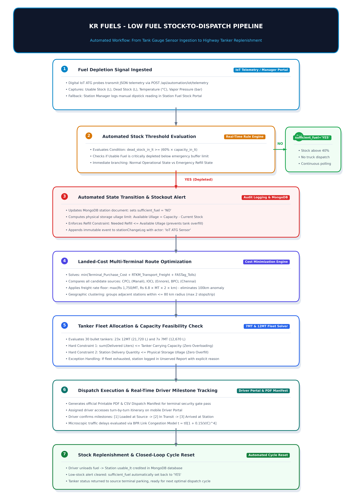

# LPG Operations Optimizer - Enterprise Auto-Dispatch & Supply Chain Optimization Platform

An end-to-end, full-stack operational platform designed to automate fuel replenishment, reduce procurement and transport freight costs, and forecast daily station consumption for retail Auto LPG networks.

---

## 📌 System Architecture & Core Pillars

The platform is architected around three foundational pillars:
1. **Automated Stock Monitoring & Depletion Detection:** Real-time ingestion of IoT Automatic Tank Gauge (ATG) telemetry to instantly identify critically depleted stations.
2. **Multi-Terminal Landed-Cost Route Optimization:** Dynamic sourcing and vehicle routing solver that evaluates refinery prices, RTKM transport tariffs, and NHAI FASTag tolls across candidate terminals.
3. **Machine Learning Demand Forecasting:** Enterprise chronological time-series forecasting across network stations to optimize buffer inventory and replenishment quantities.

```
┌─────────────────────────────────────────────────────────────────────────────────────────────┐
│                                 CORE OPERATIONAL WORKFLOW                                   │
│                                                                                             │
│  [ IoT ATG Sensor / ] ──> [ Stock Depletion ] ──> [ Landed-Cost ] ──> [ Balanced Partition ]│
│  [ Dipstick Portal  ]     [ Threshold (60%) ]     [ Terminal Opt]     [ Clustering (≤80km) ]│
│                                                          │                                  │
│                                                          ▼                                  │
│  [ Stock Credited & ] <── [ Driver Portal & ] <── [ Fleet Capacity] <── [ Proportional     ]│
│  [ Cycle Closure    ]     [ Manifest Export ]     [ Allocation    ]     [ Fairness Split    ]│
└─────────────────────────────────────────────────────────────────────────────────────────────┘
```

---

## 🗺️ System Flow Diagram

The complete end-to-end replenishment lifecycle is illustrated below:



---

## 📏 Distance Calculation & Routing Engine

Accurate road distance and transit cost metrics are fundamental to operational cost minimization. The system implements a two-tier hybrid architecture with in-memory memoization:

### 1. Live Road Routing: Google Routes API v2
* **Endpoint:** `https://routes.googleapis.com/directions/v2:computeRoutes`
* **Commercial Vehicle Profile:** Configured with `travelMode: "DRIVE"` and `emissionType: "DIESEL"` for heavy commercial tankers.
* **Toll Evaluation:** Ingests `travelAdvisory.tollInfo` to calculate real-world FASTag toll expenses per corridor.
* **Route Selection Criterion:** When multiple route alternatives exist, the solver selects the route that minimizes:
  $$\text{Composite Score} = \text{Distance (km)} + (\text{Toll in ₹} \times 50)$$
  This objective function dynamically balances highway speed and distance against toll road expenses.

### 2. Offline / Matrix Fallback: Haversine with Circuity Multiplier
When running offline (`USE_LIVE_ROUTES=0`), during rapid pre-filtering, or when external API limits are reached, the system computes spherical great-circle distances:
$$d_{\text{great-circle}} = 2 R \arcsin\left(\sqrt{\sin^2\left(\frac{\Delta\phi}{2}\right) + \cos\phi_1\cos\phi_2\sin^2\left(\frac{\Delta\lambda}{2}\right)}\right) \quad (R = 6,371\text{ km})$$

* **Road Curvature Factor ($\times 1.3$):** Because straight-line distance underestimates actual highway routes, a standardized $1.3\times$ multiplier is applied:
  $$\text{Road Distance} \approx d_{\text{great-circle}} \times 1.3$$

### 3. NHAI FASTag Commercial Tanker Toll Formulation
When live toll data is unavailable, toll charges are evaluated using a deterministic NHAI Fastag commercial vehicle pricing model (`calculate_nhai_fastag_toll`):
* Trips under $35\text{ km}$ are classified as intra-city (zero national highway tolls).
* For trips $\ge 35\text{ km}$, toll plazas occur approximately every $55\text{ km}$:
  $$\text{Plazas} = \max\left(1, \left\lfloor\frac{\text{Distance}}{55}\right\rfloor\right)$$
* **Axle-based tariffs:**
  * **12MT 3-Axle Heavy Tankers:** ₹165 per plaza.
  * **7MT 2-Axle Commercial Tankers:** ₹115 per plaza.
* **FASTag 24-Hour Return Discount:** A 50% discount is applied to the return leg ($1.5\times$ single toll for a round trip).

### 4. Coordinate Memoization Cache
To eliminate redundant HTTP requests and prevent API quota exhaustion, computed legs are cached in `_route_cache` using coordinate keys rounded to four decimal places:
$$\text{Key} = (\text{round}(\text{lat}_1, 4), \text{round}(\text{lon}_1, 4), \text{round}(\text{lat}_2, 4), \text{round}(\text{lon}_2, 4))$$

---

## ⚙️ Operations Optimization Pipeline

The dispatch solver (`pythonLogic/route_plan_db.py` & `pythonLogic/logic3.py`) executes a sequential heuristic optimization pipeline:

### Step 1: Depletion Assessment
A retail station requires replenishment when:
$$\text{Dead Stock (L)} \ge 60\% \times \text{Capacity (L)} \quad \text{or} \quad \text{sufficient\_fuel} == \text{"NO"}$$
$$\text{Needed Quantity (MT)} = \frac{\text{Usable Capacity (L)}}{1,810\text{ L/MT}}$$

### Step 2: Multi-Terminal Landed-Cost Minimization
For every station requiring fuel, candidate supply terminals (e.g., CPCL Manali, IOCL Ennore, BPCL Chennai) are evaluated to find the terminal that minimizes total landed cost:
$$\min_{s \in \text{Sources}} \Big( \text{Terminal Purchase Price}_s + \text{RTKM Freight Cost}(s, \text{station}) + \text{FASTag Tolls} \Big)$$

#### Monotonic Freight Tariff Floor Rule:
Standard freight contracts charge flat rates for local runs and per-kilometer rates for long hauls. To eliminate the 100 km "tariff cliff edge" where routes slightly above 100 km could become cheaper than shorter journeys, the freight calculation enforces a monotonic floor:
$$\text{Freight Tariff} = \begin{cases} ₹1,750 \times \text{MT} & \text{if } \text{dist} \le 100\text{ km} \\ \max(₹1,750 \times \text{MT},\; ₹6.8 \times \text{MT} \times \text{dist} \times 2) & \text{if } \text{dist} > 100\text{ km} \end{cases}$$

### Step 3: Geographic Clustering & Balanced Partitioning
Stations assigned to the same source terminal are sorted by distance from the terminal and partitioned into multi-stop runs using `balanced_partition()`:
* **Maximum stops per tanker run:** 2 stations (`ROUTE_MAX_STOPS_PER_TRUCK = 2`).
* **Maximum inter-station grouping distance:** 80 km (`ROUTE_MAX_GROUPING_KM = 80`).
* Partitions avoid isolated single stops whenever nearby stations can be consolidated into a combined delivery leg.

### Step 4: Fleet Matching & Capacity Feasibility
The fleet consists of 30 specialized bullet tankers:
* **23 $\times$ 12MT Tankers** (Capacity: 21,720 Liters / 12 MT)
* **7 $\times$ 7MT Tankers** (Capacity: 12,670 Liters / 7 MT)

The solver selects the nearest available vehicle whose capacity satisfies the combined demand. If no single tanker can satisfy the combined demand, the largest available tanker is assigned to deliver maximum volume.

### Step 5: Demand-Weighted Proportional Split
When the combined demand of a 2-stop run exceeds tanker capacity, capacity is split based on 30-day historical average sales volume (`avg_sales`):
$$\text{Allocated Share}_i = \frac{\text{avg\_sales}_i}{\sum_{j} \text{avg\_sales}_j} \times \text{Truck Capacity}$$
* A minimum delivery threshold of $1\text{ MT}$ ($1,810\text{ L}$) per stop is enforced.
* Any remaining unmet demand is logged in the `unservedStations` collection with root-cause categorization.

### Step 6: Zero-Deadhead Parking Strategy
At trip conclusion, tankers park at the terminal rather than the last delivery station:
* Subsequent dispatch cycles originate directly from the supply terminal.
* Eliminates empty deadhead travel on the first leg of subsequent runs.

---

## 📈 Machine Learning Demand Forecasting

The forecasting engine (`pythonLogic/predict_demand.py`) provides daily sales forecasts across 81 network stations:
* **Chronological Split:** Strict 80/20 chronological train/test split preventing future lookahead leakage.
* **Feature Engineering:** Lagged sales ($t-1, t-7$), 7-day rolling mean, 7-day rolling standard deviation, and day-of-week indicators.
* **Model Benchmark:** Random Forest Regressor benchmarked against a baseline Moving Average model.
* **Scenario Projections:** Computes Base, Low (5th percentile), and High (95th percentile) demand scenarios for safety stock buffer sizing.

---

## 🚀 Optimization Engines & Enhancement Roadmap

| Area | Production Implementation | Architecture & Operational Characteristics | Roadmap Scaling Strategy |
| :--- | :--- | :--- | :--- |
| **Optimization algorithm** | **Integrated:** Google OR-Tools Multi-Depot (MD-CVRP) joint solver (with sequential heuristic fallback) | Jointly optimizes candidate supply terminal sourcing, 12MT/7MT vehicle capacity limits, and landed transit costs in the primary dispatch pipeline (`route_plan_db.py`). | Scale constraints with custom time-window scheduling (VRPTW) and dynamic pickup-and-delivery pairs. |
| **Commercial vehicle routing** | Google Routes API using `DRIVE` mode | Standard driving routes may not account for all LPG tanker restrictions, such as hazardous-material restrictions, vehicle dimensions, and weight limits. | Introduce commercial vehicle routing constraints using validated road restriction data and suitable **Heavy Goods Vehicle (HGV)** routing profiles. |
| **Routing API scalability** | Google Routes API with route caching and distance fallback | Large-scale route matrix calculations may increase API costs, latency, and quota consumption. | Integrate self-hosted **OSRM** for scalable road-distance matrix calculations, retaining Google Routes as an alternative provider. |
| **Multi-trip scheduling** | **Integrated:** Multi-Trip Vehicle Routing (MT-VRP) with shift constraints | Evaluates terminal loading (45 min), station unloading (30 min per stop), and road travel times against an 8-hour shift (`ROUTE_WORK_DAY_MIN = 480`). Reassigns vehicles returning from local runs for secondary trips (`trip_number = 2`, `n_reloads = 1`). | Dynamic multi-day driver rest-break regulations and split-shift driver handovers. |
| **Toll calculation** | Google Routes toll information where available, with distance-based estimated fallback | Estimated toll values may differ from actual toll charges and vehicle-specific tariffs. | Integrate verified toll-plaza information (NHAI TIS) or **TollGuru API** for more accurate route-wise toll estimation. |
| **Traffic integration** | Separate SUMO traffic simulation using the BPR congestion model | Simulated congestion does not directly influence the actual dispatch route assignment. | Integrate traffic-adjusted travel-time estimates into the route optimization and delivery scheduling process. |
| **Demand forecasting** | Random Forest Regressor with lag and rolling statistical features | Performance may be affected by seasonal changes, price fluctuations, and external demand factors. | Evaluate **XGBoost** and **LightGBM** with additional calendar, seasonal, and external features. |

---

## 💡 Architectural Distinction for Technical Reviews

* **Production Architecture (Implemented in Repo):**
  **Google OR-Tools MD-CVRP Engine** + **Multi-Trip Vehicle Routing (MT-VRP)** + **Sequential Heuristic Fallback** + **Random Forest Demand Regressor** + **Google Routes API v2** + **Haversine ($1.3\times$) Circuity Fallback** + **MongoDB Atlas** + **Node.js/Express** + **React/Vite Dashboard**.
* **Scale Enhancements (Next Phase Architecture):**
  Commercial hazmat tanker routing profiles + Self-hosted OSRM matrix scaling + Dedicated NHAI TIS / TollGuru toll integration + Real-time traffic ingestion into solver.

---

## 🛠️ Tech Stack & Directory Structure

* **Backend:** Node.js, Express, MongoDB (Mongoose), JWT, Bcrypt
* **Frontend:** React, Vite, Tailwind CSS, Lucide Icons
* **Optimization & Data Science:** Python 3, Pandas, Scikit-learn, Requests, OpenPyXL, Matplotlib

```
LPG-Operations-Optimizer/
├── backend/
│   ├── src/
│   │   ├── models/           # Mongoose schemas (user, source, station, truck, delivery, etc.)
│   │   ├── routes/           # REST endpoints (auth, data, automation, manager, shared)
│   │   ├── services/         # Background sync, news scrapers, and terminal price services
│   │   └── index.js          # Express app entry point
│   └── package.json
├── frontend/
│   ├── assets/               # Branding assets and system workflow flowchart diagram
│   ├── src/                  # React dashboard, driver portal, manager views, and reports
│   └── package.json
├── pythonLogic/
│   ├── logic3.py             # Core heuristic routing, toll logic, and Excel workbook generator
│   ├── route_plan_db.py      # Database-driven dispatch engine (invoked by backend)
│   ├── predict_demand.py     # Machine Learning demand forecasting pipeline (Random Forest)
│   ├── sumo_traffic_sim.py   # BPR highway congestion simulation module
│   ├── generate_flowchart_image.py # System architecture flowchart generator
│   └── requirements.txt      # Python dependencies
├── data/                     # Seed datasets (clean_stationss.xlsx, sources.xlsx, sales_data.xlsx)
└── README.md
```

---

## ⚡ Prerequisites & Environment Variables

* **Node.js:** 18.x or later
* **Python:** 3.10+ with `pip`
* **MongoDB:** Local instance or MongoDB Atlas cluster

### Routing Environment Knobs (`.env`):
```env
MONGO_URI=mongodb://localhost:27017/operations_optimization
DB_NAME=operations_optimization
GOOGLE_API_KEY=your_google_routes_api_key_here
USE_LIVE_ROUTES=1
ROUTE_MAX_STOPS_PER_TRUCK=2
ROUTE_MAX_GROUPING_KM=80
ROUTE_SPLIT_LOOKBACK_MONTHS=1
ROUTE_SOURCE_ASSIGNMENT_WORKERS=4
PYTHON_PATH=python
```

---

## 🚀 Getting Started

### 1. Install Backend Dependencies
```bash
cd backend
npm install
```

### 2. Install Frontend Dependencies
```bash
cd frontend
npm install
```

### 3. Install Python Dependencies
```bash
pip install -r pythonLogic/requirements.txt
```

### 4. Seed Data into MongoDB
From the `backend/` directory:
```bash
npm run import-data
```
This reads `sources.xlsx`, `clean_stationss.xlsx`, and `truck_positions.json` and populates the database collections.

### 5. Run Backend Server
```bash
cd backend
npm run dev
```
Backend runs on `http://localhost:5000`.

### 6. Run Frontend Application
```bash
cd frontend
npm run dev
```
Frontend runs on `http://localhost:5173`.

---

## 🔐 Authentication & Roles

* **Admin Role:** Full access to route optimization, data import, analytics dashboard, fleet management, and driver dispatch logs.
* **Station Manager Role:** Access to individual station fuel telemetry, manual dipstick reading logging, and local delivery status.

Default admin credentials initialized on startup:
```json
{
  "username": "admin@krfuels.com",
  "password": "Admin@123"
}
```

---

## 📄 License
This project is licensed under the MIT License - see the [LICENSE](LICENSE) file for details.
